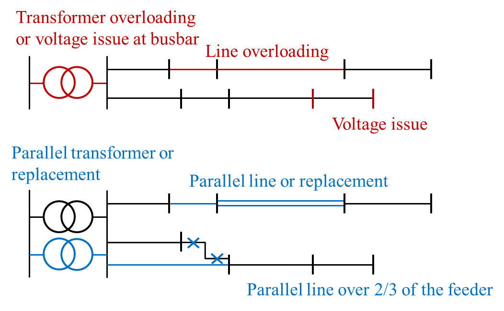
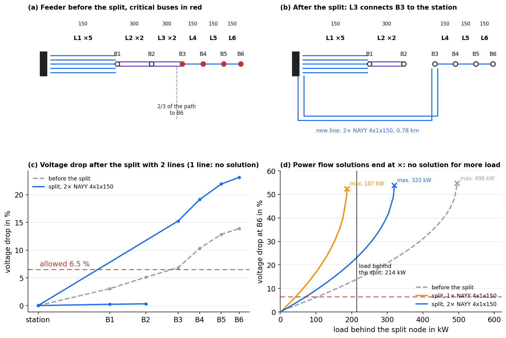
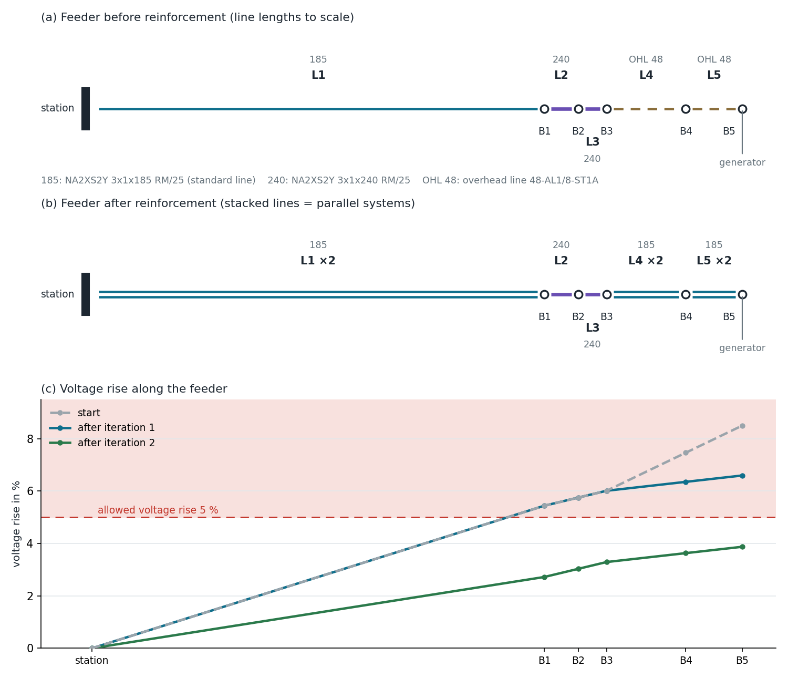

.. _grid-reinforcement:
.. _grid_expansion_methodology:

Grid reinforcement
==================

In plain terms
--------------

*Reinforcement* (grid expansion) is eDisGo's answer to the question "what does it
cost to make this grid handle the load and generation?". It looks for lines and
transformers that are overloaded and buses whose voltage is out of bounds, then
applies the measures a German distribution grid operator would typically use
(parallel cables, bigger/extra transformers, split feeders) until all problems are
solved — and reports the cost.

How it works
------------

Reinforcement is orchestrated by
:py:func:`~edisgo.flex_opt.reinforce_grid.reinforce_grid` (exposed as
:meth:`~edisgo.edisgo.EDisGo.reinforce`). It runs the following measures in order:

#. Reinforce stations and lines due to **overloading**.
#. Reinforce **MV lines** due to voltage issues.
#. Reinforce **distribution substations (MV/LV stations)** due to voltage issues.
#. Reinforce **LV lines** due to voltage issues.
#. Reinforce stations and lines due to overloading **again** — the lower impedance
   created by the voltage measures can produce new overloads.

   Grid reinforcement measures and the order in which issues are identified and
   solved.

Overloading is usually fixed in a single step. Voltage issues can only be solved
**iteratively**: after each measure a power flow is run and the voltages are
re-checked, up to ``max_while_iterations`` times (default 20).

Useful options of :meth:`~edisgo.edisgo.EDisGo.reinforce`:

* ``copy_grid=True`` — compute the needs without changing the grid topology.
* ``mode`` — restrict to ``"mv"``, ``"mvlv"`` or ``"lv"``.
* ``split_voltage_band`` — split the allowed voltage band between the voltage levels
  MV, MV/LV stations and LV (default ``True``; see below).
* ``reduced_analysis`` — only analyse the most critical time steps to save time.
* ``catch_convergence_problems=True`` — fall back to
  :py:func:`~edisgo.flex_opt.reinforce_grid.catch_convergence_reinforce_grid`, which
  handles non-convergence in stages: it first reinforces using only the converging
  time steps, then the initially non-converging ones, and only as a last resort scales
  the time series iteratively (starting from a minimal factor of 0.05 and increasing
  it, for up to 10 iterations).

Enhanced reinforcement
----------------------

On very large or heavily overloaded grids even
``catch_convergence_problems=True`` can fail to find a feasible grid.
:py:func:`~edisgo.flex_opt.reinforce_grid.enhanced_reinforce_grid` is a more robust
wrapper that reinforces **voltage level by voltage level** and falls back to ever
more drastic measures until a grid is found on which the power flow converges:

#. **Separate heavily overloaded LV grids** (if ``separate_lv_grids=True``,
   default). An LV grid whose overloading exceeds ``separation_threshold`` times the
   nominal apparent power of its MV/LV transformer(s) is split by adding a new MV/LV
   station (:py:func:`~edisgo.flex_opt.reinforce_grid.run_separate_lv_grids`).
#. **Reinforce each LV grid on its own.** If a single LV grid does not converge in
   the power flow, it is split first
   (:py:func:`~edisgo.flex_opt.reinforce_measures.separate_lv_grid`) and then
   reinforced.
#. **Reinforce everything at once.** If that fails, it runs, **in sequence** (each
   step is attempted regardless of whether the previous one succeeded), the **MV**
   level only, then **MV + MV/LV stations** (``mode="mvlv"``), then each **LV grid
   separately** (again splitting any that do not converge).
#. **Cost-distorting last resort** (only if
   ``activate_cost_results_disturbing_mode=True``). For LV grids that still cannot be
   solved, first **all lines are replaced by the standard line type**; if that is
   still not enough, **all components of the LV grid are aggregated onto the MV/LV
   station bus**. These measures restore convergence but distort the reported costs:
   the line replacement is recorded in ``equipment_changes`` and *does* enter the cost
   calculation, whereas the aggregation leaves no costed trace, so the total is an
   *underestimate* (a warning is logged and recorded in ``edisgo.results.measures``).
#. A final full reinforcement is run over the now-feasible grid. Note that the
   fallback sequence in step 3, the cost-distorting measures in step 4 and this final
   reinforcement only run if the *"everything at once"* attempt at the start of step 3
   fails; if it converges right away, the function returns at that point.

Use it when a normal :meth:`~edisgo.edisgo.EDisGo.reinforce` raises convergence or
iteration errors; for well-behaved grids the standard reinforcement is sufficient.

.. note::

   The MV line reinforcement that splits a feeder with **voltage issues** at an LV
   station does not yet actually insert a switch disconnector at the split point
   (``TODO`` in :py:func:`~edisgo.flex_opt.reinforce_measures.reinforce_lines_voltage_issues`),
   so the resulting half-rings are not switchable in the model. See
   :ref:`switches-explained` for the role of switch disconnectors in reinforcement.

Identifying problems
--------------------

Constraint checking lives in
:py:mod:`~edisgo.flex_opt.check_tech_constraints`.

**Overloading** is determined from allowed *load factors*
(:ref:`config_grid_expansion`, section ``grid_expansion_load_factors``). These factors
can differ between load and feed-in case (:ref:`load-feedin-case`), but for normal
operation they all default to 1.0; case-dependent factors (e.g. 0.5 for the MV load
case) exist only in the currently unusable n-1 section.

* Lines: :py:func:`~edisgo.flex_opt.check_tech_constraints.mv_line_max_relative_overload`
  and :py:func:`~edisgo.flex_opt.check_tech_constraints.lv_line_max_relative_overload`
  return lines whose relative loading exceeds 1.0. The allowed and relative loads are
  computed by :py:func:`~edisgo.flex_opt.check_tech_constraints.lines_allowed_load`
  and :py:func:`~edisgo.flex_opt.check_tech_constraints.lines_relative_load`. The
  allowed current uses the manufacturer's ``I_max_th`` (tables
  :ref:`lv_cables_table`, :ref:`mv_cables_table`, :ref:`mv_lines_table`).
* Stations:
  :py:func:`~edisgo.flex_opt.check_tech_constraints.hv_mv_station_max_overload` and
  :py:func:`~edisgo.flex_opt.check_tech_constraints.mv_lv_station_max_overload` use
  the transformer rating ``S_nom`` (tables :ref:`lv_transformers_table`,
  :ref:`mv_transformers_table`);
  :py:func:`~edisgo.flex_opt.check_tech_constraints.stations_relative_load` gives the
  relative loading.

**Voltage problems** are determined by
:py:func:`~edisgo.flex_opt.check_tech_constraints.voltage_issues` against the allowed
deviations in :ref:`config_grid_expansion` (section
``grid_expansion_allowed_voltage_deviations``). With ``split_voltage_band=True``
(default) the band is split between MV, MV/LV stations and LV, which get separate
limits — a combined limit can leave almost no room in the LV grids when the MV
deviation is already close to the limit.
:py:func:`~edisgo.flex_opt.check_tech_constraints.voltage_deviation_from_allowed_voltage_limits`
returns the absolute deviations.

Physics
-------

* **Loading / current.** A line's apparent power must stay below
  :math:`S_\text{allowed} = S_\text{nom}\cdot \text{load factor}`, with the current
  :math:`I = S / (\sqrt{3}\,V)`. A transformer's loading uses
  :math:`S = \sqrt{P^2 + Q^2} \le S_\text{nom}\cdot \text{load factor}`.
* **Voltage.** The voltage deviation along a feeder is approximately
  :math:`\Delta V \approx I\,Z` (with line impedance :math:`Z = R + \mathrm{j}X`).
  The configured allowed deviations follow DIN EN 50160 (combined ±10 %) and
  VDE-AR-N 4105 (LV voltage drop); the component-connection limits in
  ``config_grid`` additionally reference VDE-AR-N 4100/4110. Reinforcement reduces
  :math:`\Delta V` either by lowering :math:`Z` (parallel lines, shorter feeders) or
  by adding transformer capacity.

Reinforcement measures
----------------------

Measures are implemented in :py:mod:`~edisgo.flex_opt.reinforce_measures`.

Lines due to overloading
~~~~~~~~~~~~~~~~~~~~~~~~~~

:py:func:`~edisgo.flex_opt.reinforce_measures.reinforce_lines_overloading` decides per
line up front, in three cases: lines that are already of standard type get as many
additional parallel standard lines as needed; single-circuit **cables** with a
relative overload below 2 get one parallel line of the **same** type; all other lines
are **replaced** by as many parallel standard lines as needed.

Stations due to overloading
~~~~~~~~~~~~~~~~~~~~~~~~~~~~~

:py:func:`~edisgo.flex_opt.reinforce_measures.reinforce_hv_mv_station_overloading`
and :py:func:`~edisgo.flex_opt.reinforce_measures.reinforce_mv_lv_station_overloading`
add a parallel transformer of the existing type (the smallest one that solves the
problem if several exist); otherwise the existing transformers are **replaced** by as
many standard transformers as needed to cover the previous plus the missing capacity.

MV/LV stations due to voltage issues
~~~~~~~~~~~~~~~~~~~~~~~~~~~~~~~~~~~~~~

:py:func:`~edisgo.flex_opt.reinforce_measures.reinforce_mv_lv_station_voltage_issues`
installs a parallel standard transformer, re-runs the power flow and repeats until
the voltage is within limits or the iteration limit is reached.

Lines due to voltage issues
~~~~~~~~~~~~~~~~~~~~~~~~~~~~~

:py:func:`~edisgo.flex_opt.reinforce_measures.reinforce_lines_voltage_issues`
addresses, per feeder, the critical node **farthest from the station** (by path
length). Only one voltage problem per feeder is treated per iteration, because each
measure affects the whole feeder. There are two measures:

* the feeder is **split** and its rear part is connected to the station by a new line
  (:ref:`feeder-split`), or,
* if the node at two thirds of the path is already directly connected to the
  station, so there is nothing to split, the **lines on the path** to the critical
  node are reinforced (:ref:`path-reinforcement`).

Both measures are rules of thumb; what they cannot do is summarised in
:ref:`voltage-reinforcement-limits`.

.. _feeder-split:

Splitting a feeder
""""""""""""""""""

#. **Find the split node.** It is the first node on the path to the critical node at
   or beyond two thirds of the path length. In **LV** grids it is moved back towards
   the station until it lies outside a building, as loads and generators in buildings
   cannot be connected to the station directly. In **MV** grids it is moved forward to
   the next LV station, as only LV stations have the switch disconnectors needed to
   operate the feeder as a half ring; if there is none up to the critical node, the
   critical node itself is connected to the station.
#. **Connect it to the station.** The line ending at the split node, the **split
   line**, is disconnected from its predecessor and connected to the station. It
   becomes **one standard line** (``lv_line``, ``mv_line_10kv`` or ``mv_line_20kv`` in
   :ref:`config_grid_expansion`) with the length of the path from the station to the
   split node, i.e. the new cable is assumed to be laid along the existing route. The
   split node and everything behind it now form a feeder of their own. The front part
   keeps its lines but no longer carries the load behind the split.
#. **Run the power flow.** After all feeders with voltage issues are treated, the
   power flow is repeated and the voltages are checked again. If it does not converge,
   see :ref:`feeder-split-weaker-line`.

The two thirds come from the distribution grid study of Baden-Württemberg ([BW]_).
For a uniformly loaded feeder of length :math:`L` that is split at :math:`a` and fed
again by a new line of the **same type**, the voltage drop at the end of the front
part is proportional to :math:`a^2/2` and at the end of the rear part to
:math:`(L^2 - a^2)/2`. The larger of the two is smallest where both are equal, at
:math:`a = L/\sqrt{2} \approx 0.71\,L`; two thirds is an approximation of this.

.. _feeder-split-weaker-line:

When the split line is weaker than the bypassed path
^^^^^^^^^^^^^^^^^^^^^^^^^^^^^^^^^^^^^^^^^^^^^^^^^^^^^

The split line replaces the path from the station to the split node for everything
behind the split. Usually the old path consists of thinner or older cables, and the
standard line has a lower resistance. If the path is built from thicker or parallel
cables, the split line can have a **higher** resistance than the path it bypasses,
while it carries the whole load behind the split.

Then the voltage behind the split gets worse instead of better, and with enough load
the power flow has **no solution** at all, because a line can transfer only a limited
power to its end. For a purely resistive line with the voltage :math:`U` at the
station this limit is

.. math::

   P_\mathrm{max} = \frac{U^2}{4R},

reached when half of the voltage drops along the line; beyond it, a larger current
reduces the voltage more than it increases the power. Reactive power lowers the limit
further. The Newton-Raphson power flow then does not converge.

So that reinforcement does not abort in this case, the following is done if the power
flow after a reinforcement step due to voltage issues does not converge and feeders
were split in that step (``_analyze_after_voltage_reinforcement`` in
:py:mod:`~edisgo.flex_opt.reinforce_grid`):

#. **Find the grids that cause it.** Every LV grid with split lines is analysed on its
   own (``mode="lv"``, only the time steps that did not converge). This finds the few
   LV grids without a solution among the many reinforced in one step. If all split
   lines are in one grid, e.g. the MV grid, this check is skipped.
#. **Add a parallel line** to the split lines of the LV grids that do not converge on
   their own, or to all split lines of the step if every LV grid converges on its own
   or the check was skipped.
#. **Repeat the power flow** with the same settings as the reinforcement step. If it
   still does not converge, steps 1 and 2 are repeated for the split lines that got a
   parallel line, in up to four rounds, i.e. at most four additional lines per split
   line. After that, the power flow error is raised.

The added lines are written to ``equipment_changes`` and are part of the costs. In
grids whose power flow converges after the split, nothing changes.

The example below shows an LV feeder with six lines in two variants: older, thinner
cables, where the split works as intended, and a feeder with a thick first section,
in which L1 has five parallel NAYY 4x1x150 and L2 and L3 have two parallel
NAYY 4x1x300 each, modelled on a real LV grid after spatial complexity reduction.
Loads have a :math:`\cos\varphi` of
about 0.95, the allowed voltage drop is 6.5 % (``lv_max_v_drop`` with
``split_voltage_band=True``), and the voltages come from a Newton-Raphson power flow
of the example feeder.

.. only:: html

   Select a variant and move the slider to go through the split step by step. The
   lower chart shows the voltage drop at the end of the feeder for increasing load
   behind the split node; a curve ends where the power flow has no solution.

   .. raw:: html
      :file: feeder_split.html

   Split of the feeder with a thick first section. (a) B3 to B6 exceed the allowed
   voltage drop; the split node is B3, the first bus beyond two thirds of the path to
   B6. (b) L3 is connected to the station as a 0.78 km standard line. With one line
   (0.161 Ω instead of 0.036 Ω for the bypassed path) the power flow has no solution:
   at most 187 kW can be supplied behind B3, which has 214 kW. (c) With a second,
   parallel line the power flow converges, but the voltage drop at B6 is larger than
   before the split. (d) Voltage drop at B6 over the load behind B3; each curve ends
   at the largest load for which a power flow solution exists.

In this example, the split with two parallel lines makes the voltage at B6 worse than
before. The next iteration treats the new feeder: its node at two thirds is B3, which
is now directly connected to the station, so the lines on the path are reinforced as
described in the next section.

.. _path-reinforcement:

Reinforcing lines on the path to the critical node
""""""""""""""""""""""""""""""""""""""""""""""""""""

The split node at two thirds of the path is often the first node of the feeder, for
example when an earlier iteration split the feeder and installed a long new line from
the station. Then no line can be split and the lines on the path from the station to
the critical node are reinforced. In every iteration of the grid reinforcement, the
helper ``_reinforce_lines_on_path`` in
:py:mod:`~edisgo.flex_opt.reinforce_measures` does the following:

#. **Estimate how much needs to be removed.** The voltage deviation at the critical
   node is divided by the voltage difference between station and critical node:

   .. math::

      share = \frac{\Delta u_\mathrm{deviation}}{|u_\mathrm{node} - u_\mathrm{station}|}

#. **Set the target.** The voltage difference along the path is estimated as
   :math:`\sum_i r_i \cdot I_i`, the resistance times the current of each line on the
   path at the time step of the voltage issue. It is to be reduced by
   :math:`share / 2`. Only half of the share is used, because using the full share
   led to more reinforcement than needed in the test grids. Remaining voltage issues
   are handled in the next iteration, after a new power flow.

#. **Reinforce one line at a time.** For every line on the path, the reduction of
   :math:`r \cdot I` and the cost of the possible measure are calculated:

   * a line of standard type gets one more parallel line, which reduces its resistance
     from :math:`r` to :math:`r \cdot n / (n + 1)` for :math:`n` parallel lines,
   * any other line is replaced by one standard line, unless this would increase its
     resistance, e.g. because it has a larger cross section than the standard line. In
     that case it gets a parallel line of the same type.

   The cost of a measure is the cost of the new cable plus the earthwork, if the line
   was not reinforced before. Earthwork is paid only once per line (see
   :ref:`grid-expansion-costs`), so another parallel line on an already reinforced
   line is cheaper than reinforcing a new one. The measure with the largest reduction
   of :math:`r \cdot I` per cost is applied, until the target is reached.

The example below shows a 10 kV feeder with five lines. A generator at B5 and a PV
plant at B3 raise the voltage at all buses above the allowed 5 %. The current on L1 to
L3 is 1.4 times the current on L4 and L5, because the PV plant feeds in at B3. The
example uses a simplified model in which the voltage rise is proportional to
:math:`\sum r \cdot I` and costs follow the default costs for rural MV cables (60 kEUR/km
earthwork, 20 kEUR/km cable); eDisGo itself runs a power flow after every iteration.

.. only:: html

   Move the slider to go through the reinforcement measure by measure. The table shows,
   for every line, the measure that would be applied, its reduction of
   :math:`r \cdot I` and its costs. The highlighted row is the chosen measure.

   .. raw:: html
      :file: voltage_path_reinforcement.html

   Reinforcement of the example feeder. In the first iteration, the overhead lines L4
   and L5 are replaced by standard lines and then get a second, parallel standard line,
   which is cheap because the earthwork is already paid. In the second iteration L1,
   which carries the highest current, gets a parallel line. L2 and L3 are not changed,
   as a standard line would increase their resistance.

.. _voltage-reinforcement-limits:

Limits of line reinforcement due to voltage issues
""""""""""""""""""""""""""""""""""""""""""""""""""""

Both measures follow rules of thumb of grid planning and are corrected by the power
flow of the next iteration; they are not optimised. This keeps reinforcement fast and
close to what a grid operator would do, but has limits:

* **The split node only depends on the path length.** Loads and line types are not
  considered. With unevenly distributed loads, or in grids reduced by the
  :ref:`spatial complexity reduction <complexity-reduction>` with few buses per
  feeder, the bus after two thirds can carry most of the load of the feeder.
* **The split line is not compared with the bypassed path.** It is always one
  standard line. Where the path is thicker or has parallel lines, the voltage behind the split
  gets worse, also when the power flow still converges. This is not detected as such;
  it shows up as a voltage issue in the next iteration and is then solved by
  reinforcing the lines on the path, which can cost more than reinforcing the old path
  directly would have.
* **Parallel lines after a non-converging power flow restore convergence, they do not
  size the line.** The smallest number of lines with which the power flow converges is
  installed, not the number that solves the voltage issue. In the example above, the
  voltage drop at B6 with two lines is 23 % instead of 14 % before the split.
* **LV grids are checked on their own**, with the slack at the secondary side of the
  MV/LV station. If the power flow of the whole grid does not converge although each
  LV grid converges on its own, the cause cannot be attributed, and all split lines of
  the step get a parallel line, more than needed. Split lines in the MV grid always
  get one. The check costs one power flow per LV grid with split lines.
* **The cause of a non-converging power flow is not checked.** If feeders were split
  in the step, up to four parallel lines are added to them before the error is raised,
  even if the power flow does not converge for another reason.
* **The loading of the split line is not checked when splitting.** An overloaded
  split line is reinforced in the final step due to overloading (see `How it works`_).
* **The split line follows the existing route.** Its length, and therefore its cost, is
  the length of the path to the split node; a shorter route is not searched for. In MV
  grids no switch disconnector is inserted at the split node (see the note in
  `Enhanced reinforcement`_).
* **Path reinforcement uses a linear estimate.** The voltage difference along the path
  is estimated as :math:`\sum r \cdot I` with the currents of one time step, the one
  with the largest deviation at the critical node, before reinforcement. Reactance and
  the change of the currents by the reinforcement are neglected, and the factor of one
  half on the share is empirical (see :ref:`path-reinforcement`).

Separating overloaded LV grids
~~~~~~~~~~~~~~~~~~~~~~~~~~~~~~~~

:py:func:`~edisgo.flex_opt.reinforce_measures.separate_lv_grid` splits a heavily
overloaded LV grid by adding a new MV/LV station, redistributing the load.

.. _grid-expansion-costs:

Grid-expansion costs
--------------------

Costs are computed by :py:func:`~edisgo.flex_opt.costs.grid_expansion_costs` (which
uses :py:func:`~edisgo.flex_opt.costs.line_expansion_costs`;
:py:func:`~edisgo.flex_opt.costs.transformer_expansion_costs` is a standalone helper
not called by it). The total is the sum of the cost of every added transformer and
line. Costs are distinguished only by voltage level, not by equipment type, and for
lines additionally by whether they run in a **rural** (≤ 500 inhabitants/km², lower
earthwork cost) or **urban** area ([DENA]_). Unit costs come from
:ref:`config_grid_expansion`.

References
----------

.. [BW] C. Rehtanz et al.: *Verteilnetzstudie für das Land Baden-Württemberg*. 2017.
.. [DENA] A.C. Agricola et al.: *dena-Verteilnetzstudie: Ausbau- und
   Innovationsbedarf der Stromverteilnetze in Deutschland bis 2030*. 2012.
